# Shimashima: the blue print behind the website, taken apart

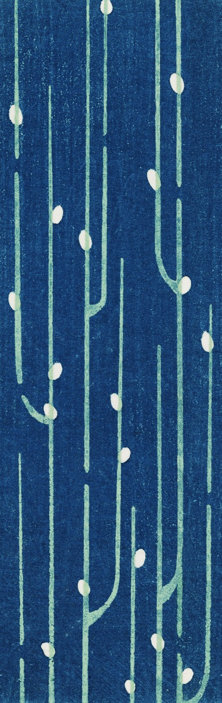

## What this is

The same job as the Iceland map study, done on the blue picture that tiles behind `alyoshalatyntsev.github.io`: measure how it looks, cut its textures out as files, read off where every line and oval sits, and then draw it again from those parts. Drawing is in two steps. A **layout file** says where the stems, forks and buds go, and a person can edit it. A **renderer** draws whatever layout it is given with the textures from the scan.

Words used below: a **stem** is one of the pale lines (a branch, when it grows out of another stem); a **bud** is one of the white ovals (the leaves); the **ground** is the dark blue.

| | |
|---|---|
| `textures/` | the parts cut from the scan: ground, stem ribbons, stem fills, paper, every bud and its outline, the three masks, the tile |
| `layout-original.json` | the topology of the print: 20 stems, 6 of them branches, 19 buds. Edit this |
| `rules.json` | the pattern's habits: lanes, lengths, gaps, forks, bud spacing |
| `measurements.json` | every colour and texture number |
| `clips/` | pictures to look at: zooms, all six forks, scan against redrawing |
| `drawn-original.jpg`, `drawn-original-site.jpg` | the print redrawn from its layout, in the scan's colours and in the website's |
| `layout-grown-1.json`, `drawn-grown-1.jpg` (and `-2`) | two new layouts made from the rules, and their drawings |
| `samples-sheet.jpg`, `sample-*.json` | four different arrangements, each plan beside its print |
| `code/` | `topology.py`, `measure.py`, `rules.py`, `draw.py`, `grow.py`, `plan.py`, `samples.py`, `compare.py` |

## To use it

```
PY="$HOME/Library/Application Support/geodaetisk-map/venv/bin/python"   # numpy, scipy, Pillow
"$PY" code/draw.py layout-original.json            # draw a layout  -> drawn-original.jpg  (3 seconds)
"$PY" code/draw.py layout-original.json --site-colours
"$PY" code/grow.py --seed 5 --height 2688          # a new layout from the rules -> layout-grown-5.json
"$PY" code/draw.py layout-grown-5.json --seed 5
```

To change where things go, edit the layout file and draw it again. To rebuild everything from the scan: `topology.py`, `measure.py`, `rules.py`, in that order.

## 1. The source file

- **The website's file is not the best copy.** `shimashima6_5.jpg` is `Art/shimashima6_100.jpg` turned 180°, recoloured (red channel pushed: more saturated, greener stems), then saved at JPEG quality 5. The two agree at correlation 0.987 once turned. Everything here is measured on the quality-100 scan and shown the way up the website shows it. The recolouring is a single matrix, kept in `measurements.json`, and `draw.py --site-colours` applies it.
- **The scan is one strip repeated.** The 4220 px width is the same 1344 px strip pasted 3.14 times: the copies match pixel for pixel. So there is only one tile to study, 1344 × 4248 px, cut here on columns that no stem touches (`textures/tile.jpg`).
- **It does not repeat down the page.** Top and bottom do not match, so the website's tiling has a visible seam every 4248 px of the original. The grown layouts repeat both ways.
- **Size.** The file is tagged 300 dpi, which would make the tile 114 × 360 mm. The tag may not be the true scale, so sizes below are in pixels.

## 2. How it is printed

Three things lie on the paper, and each is flat colour with a grain. This reading fits the colours but is not proved.

1. **Bare paper** shows only in the buds.
2. **Pale green** is printed as the lines. Inside a bud the stem carries on as a clean pale-green band, which is the only place the green is seen by itself.
3. **Dark blue** covers everything except the stems and buds. On the stems a thin, broken film of it lies over the green: that is the teal mottle.

Checks: the stems' colours lie on one line (97 % of their variation), running from the clean green towards the blue, and their dark end is close to "pale green under 40 % strength blue" (worst channel off by 9 of 255). The light flecks in the ground match "paper under 60 % blue" (off by 6.5), and do not match green under blue (off by 20), so the green is not under the ground.

| | Colour (scan) | |
|---|---|---|
| Paper | `#E8E7E2` | sd 4 per channel |
| Pale green (band in a bud) | `#B1D0B1` | |
| Stem, average | `#87B9AB` | from (172, 212, 191) at its lightest to (62, 132, 132) at its darkest |
| Ground, average | `#19406F` | from (9, 40, 87) to flecks of (52, 106, 152) |

## 3. Textures

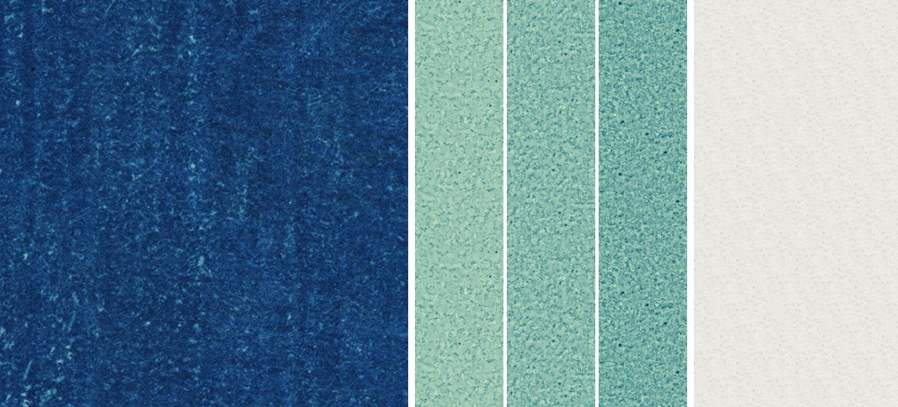

### Ground (`textures/ground-tile.png`, 1110 × 976, repeats both ways)

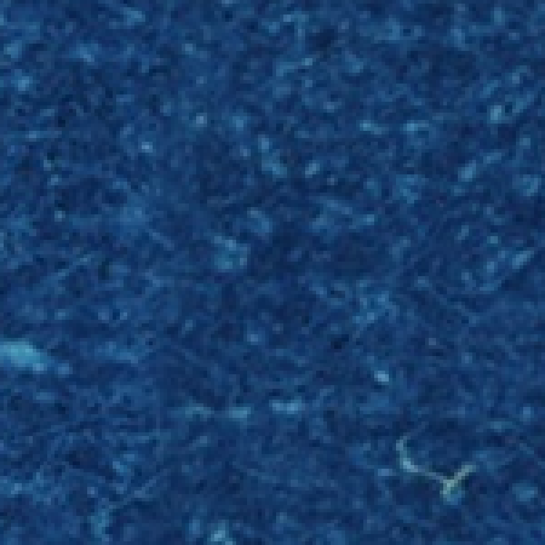

- **A fine, even grain.** Contrast is about 4 brightness levels in each size band from 2 px to 14 px and falls away above that. Two points 4 px apart are still alike (correlation 0.27); at 8 px they are unrelated. It looks the same across and down at these sizes.
- **Faint upright streaks.** Above about 30 px the ground varies 1.1 to 1.3 times more across than down. This is the streakiness seen from a distance.
- **Light flecks only.** About 11 per cm², covering 1.6 % of the ground, typically 12 px in area, some of them short curled fibres pointing every way. There are no dark specks: the grain is light showing through dark.
- **Slow unevenness.** 96 px blocks differ by an sd of 2.8 levels.
- **The file** is ten clean strips of real ground, 1024 px tall, taken from between the stems, each levelled to the mean colour and cross-faded into its neighbour. `ground-patch-largest.png` is the largest untouched piece (230 × 1024).

### Stems (`textures/ribbons/`, and `stem-fill-thin.png`, `-middling.png`, `-thick.png`)

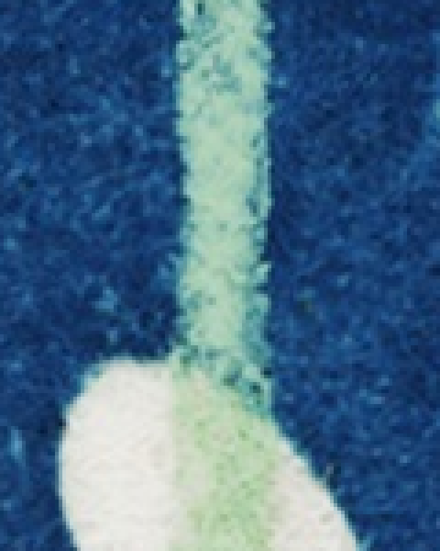

- **Mottle.** Dark teal grains on pale green, the same in every direction, forgotten within 6 px (correlation 0.36 at 2 px, 0 at 6 px). A quarter of the stem is darker than midway.
- **Patchy along the stem.** The blue lies thick on some stretches and thin on others, and whole stems differ (mean brightness 153 to 180). This slow change (sd 12 levels, over hundreds of pixels) is larger than anything at middle sizes. Hence three fill files, sorted by how much blue they carry, and the renderer slides between them along each stem.
- **Edges.** A stem edge wanders about its smooth line by 0.9 px (sd), staying alike for about 6 px, and the two edges of a stem wander independently. The step from ground to stem takes 2.4 px (20 % to 80 %). The centre line wanders 0.7 px about straight.
- **Lumps and pinches.** Beyond its steady narrowing, a stem's width wanders by 1.8 px (sd) averaged over 10 px, 1.5 px over 30 px, 1.16 px over 100 px and 0.81 px over 300 px. So the unevenness is at every length, not only the fine roughness above.
- **Ribbons.** Because of this, the renderer does not invent stems. `textures/ribbons/` holds 30 real stretches of stem body (16,977 px in all), 10 real heads and 6 real feet, each 64 px wide with a clear background, straightened only for lean. Colour, the thickness of the blue and the shape of both edges travel together (`clips/08-stem-ribbons.png`).
- **Course.** Each stem's slow bends and swellings are kept in the layout as its `course`: every 100 px, how far its real centre is from the straight line, how wide it really is, and how heavily the blue lies on it. At each bud the course is pinned to the green's own edges measured inside the bud. Most stems stray by about 1 px (sd, per stem: 0.3 to 2.8), but one bows by 19.1 px. Width strays from a plain taper by 1.1 to 2.8 px (sd).
- **Lean.** No stem is quite upright: they drift up to 15 px, once 29 px, per 1000 px, either way.
- **Width.** 16 to 38 px, median 28. Most stems narrow towards the head, typically by 5 px per 1000 px, which is what makes the long ones look pointed.
- **Ends.** Both ends are rounded off within about 20 px; the head tapers a little longer (to 80 px). See `clips/05-top-ends.jpg`, `06-bottom-ends.jpg`.
- `stem-strips-straightened.png` holds the eight longest runs of real stem, straightened, with ground either side.

### Buds (`textures/buds/bud-01.png` … `bud-19.png`, `paper-tile.png`)

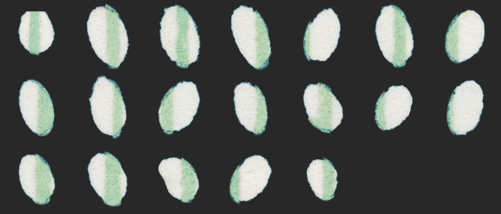

- **What a bud is.** The patch with no blue ink on it: bare paper, plus clean pale green where the stem's green lies inside it. So its outline can be read all the way round, across the stem too, where clean green meets the mottled stem.
- **Shape.** Egg and pear shapes, often pointed where they sit on the stem. Lengths 86 to 134 px (median 112), 0.53 to 0.81 as wide as long, and each outline stands in or out of its fitted oval by up to about 12 %. They are larger towards the top of the tile (correlation of length with height on the page -0.46), which may be chance in a sample of 19.
- **Outlines.** `textures/bud-shapes.json` holds all 19 as the distance from centre to edge in 144 directions. One (the first) is cut by the tile's top edge and is not used for new buds.
- **Paper.** Very quiet: sd 3.8 levels, with a fine tooth of about 1 level at 2 to 7 px.
- **The green.** It is the stem and nothing else: the same width as the stem outside the bud and centred on it. The stem crosses off-centre by 4 to 41 px, so the bud sits to one side of its stem, and several show a sliver of white on the far side too.
- **Halo.** The ground is darker close to a bud: about 10 % darker within 8 px, 4 % at 8 to 16 px, in every direction and round all 19. Stems have no such halo.
- **Edge.** Paper to ground takes about 2.2 px.
- Each bud is cut out with a clear background, numbered down the page. `paper-tile.png` is made from five small pieces of paper and shows the grain only.

## 4. Topology and rules

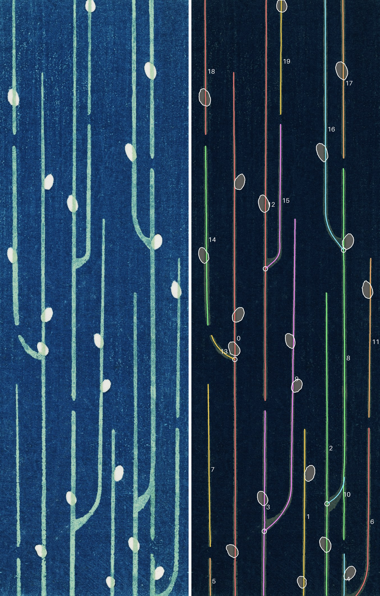

The tile holds 20 stems and 19 buds (`layout-original.json`). All six forks are in `clips/04-all-forks.jpg`.

**How it was read.** The stems are near enough upright that each row of the picture can be cut into runs of stem and the runs linked from row to row. Two runs becoming one is a branch joining its parent. Each branch's curve is then fitted with three numbers and each bud with an ellipse.

**A branch** leaves its parent at `join_y`, runs straight at `angle` from the parent's direction, then turns upright on an arc of `radius`, ending `reach` to the side. The curve is first fitted to the traced centre line, then refitted against the motif's shape round the fork, since below the point where branch and parent merge there is no centre line to follow.

What the tile shows (`rules.json`):

- **Lanes.** Upright stems stand on nine vertical lines, 81 to 216 px apart.
- **End to end.** Within a lane, stems follow one another with a gap of 65 to 97 px (median 71) between one stem's foot and the next one's head. Six lanes also have a long blank of 390 px or more.
- **Lengths.** Whole stems are 990 to 2650 px long; others are cut by the tile's edge at up to 3730 px.
- **Feet.** Of twelve feet in view, eight end free and four join the stem in the next lane. Every fork opens upward.
- **Forks.** Reach 107 to 199 px (the distance to the next lane), angle 40° to 70°, radius 80 to 400 px. Four go right, two left.
- **Two odd ones.** One branch is a hook: it stops 177 px up, before it has turned upright. One runs into the neighbouring stem and merges with it, and that stem carries on for 450 px below the point where the branch has turned into it.
- **Buds.** One per 1452 px of stem. 12 sit left of their stem, 7 right. They lean away from the stem by up to 36° (1 of 19 lean the other way). No two are closer than 231 px. Two of the six forks have a bud on the parent just above the join.

## 5. Drawing it again

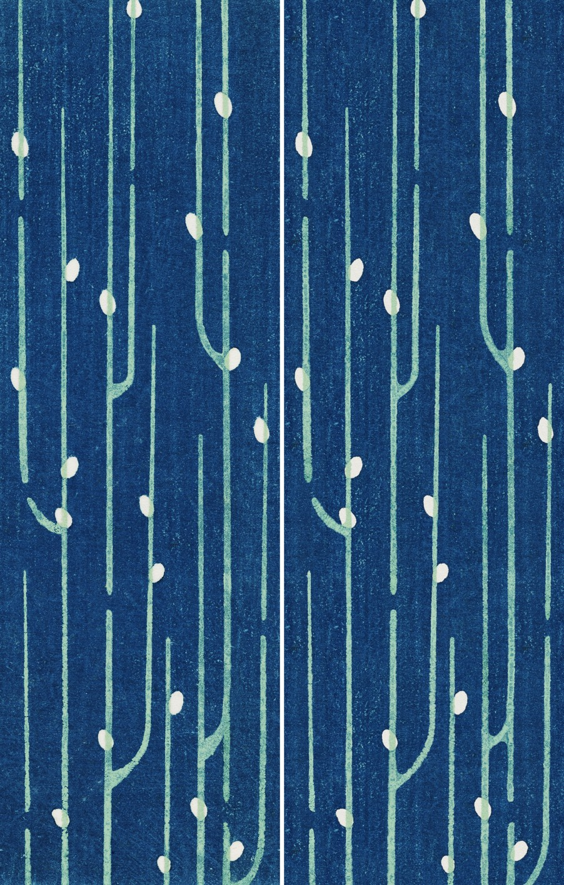

Left is the scan; right is `layout-original.json` drawn by `draw.py`. Mean colour and overall contrast agree (brightness sd 43.4 against 43.4). Close up:

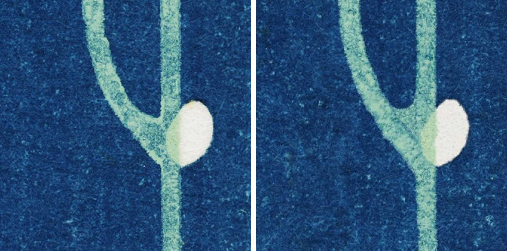
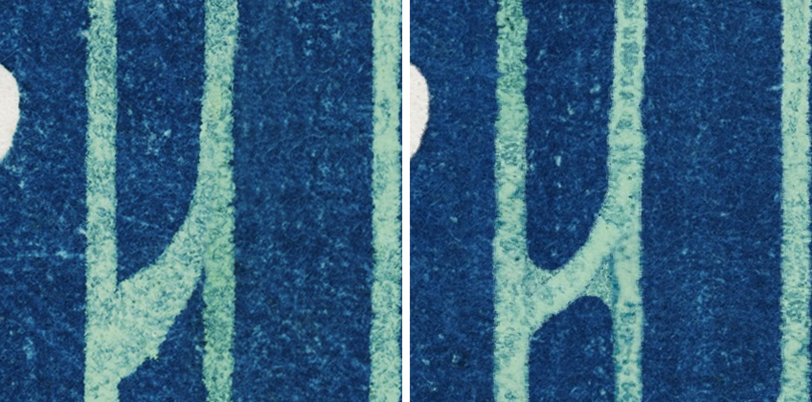

The renderer lays real ribbons of stem along each centre line in the layout: a real head, stretches of real body cross-faded end to end, a real foot, squeezed or spread to the width the layout asks for and bent round the forks. It webs over the inside of each fork, draws each bud with a real bud's outline, darkens the ground close round each bud and deepens the stem's mottle where it meets one, and fills ground and paper from the texture files.

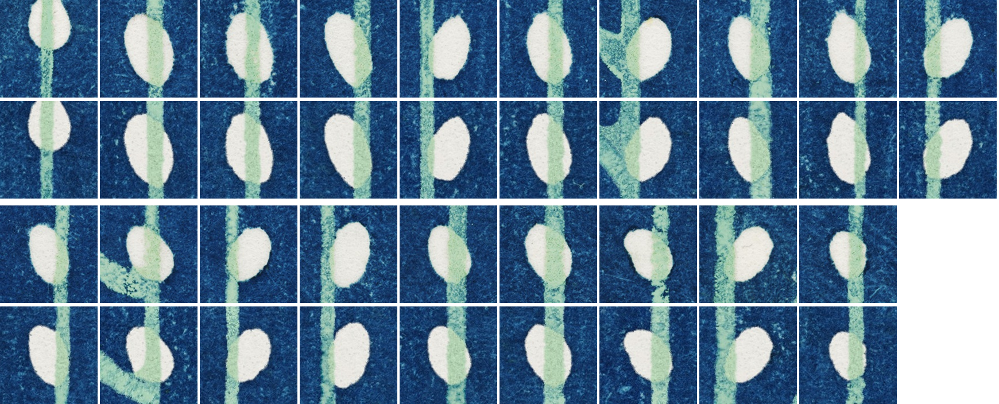
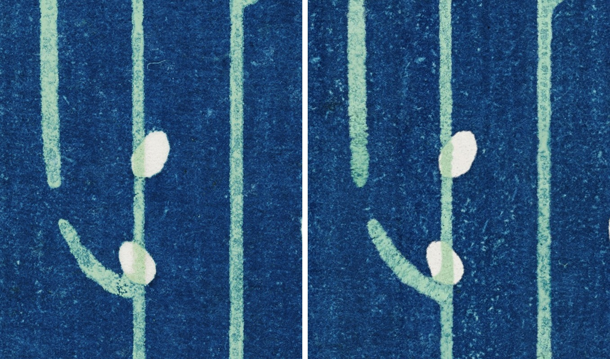

`code/plan.py <layout>.json` draws a layout as a plan: red lines for the stems, a dot where a branch leaves its parent, a bar at each free end, an outline for each bud. `code/samples.py` grows four differently arranged layouts (how many feet fork, how many twigs, how many buds are options of `grow.py`) and sets each plan beside its print:

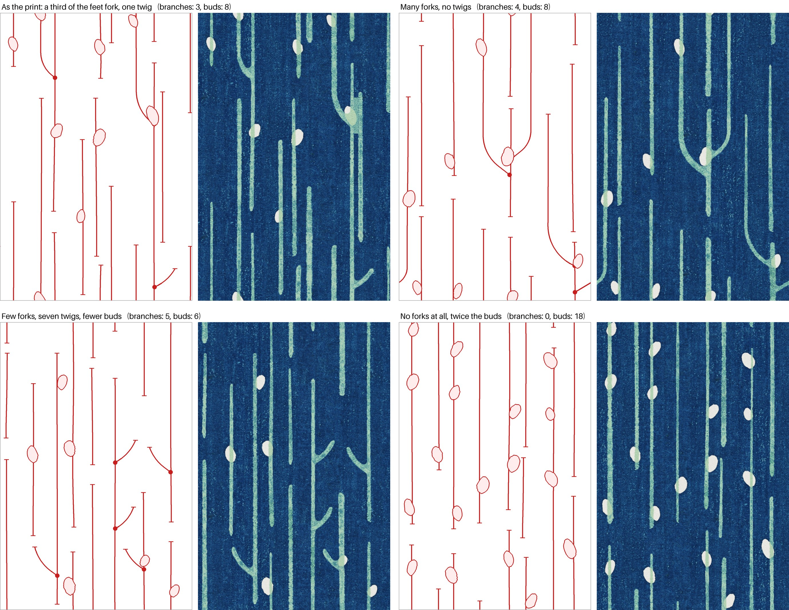

Two layouts grown from the rules, each repeated 2 × 2 to show that they join:

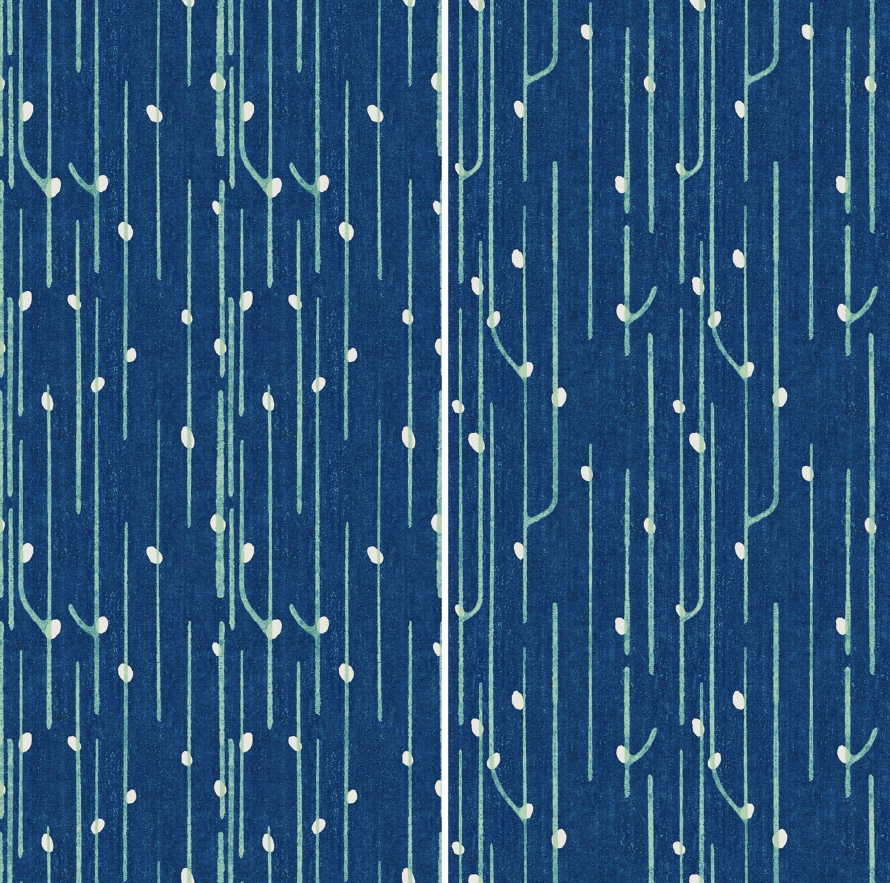

## For the website

`code/webtile.py` makes a small background tile that repeats exactly across and down: a new layout (1344 × 2016 scan pixels) shrunk to 600 px wide, the width the site's present background is shown at. `web/` holds it as WebP (about 69 KB) and AVIF (about 46 KB), in the scan's colours and in the website's, with a double-size AVIF for sharp screens (about 98 KB) and a test page, `web/test-page.html`, that tiles it and prints the style rule to use.

`code/animate.py` makes a drifting version: the same kind of layout, with each group of stems sliding up at its own speed (`animation/drift.html`).

## 6. What is weak

- **One tile is a small sample.** Six forks and nineteen buds give pools of what was seen, not laws. `grow.py` draws from those pools, and its choices beyond them (how often a lane has a long blank, where a hook may go) are mine.
- **Stems are re-used.** There are about 17,000 px of real stem body to draw from, so a large picture repeats stretches of it (mirrored half the time). Fork curves bend ribbons that were cut from straight stems.
- **Stem ink is matched only roughly.** A stem's course says how heavily it is inked every 100 px; the renderer prefers real stretches of about that inking and then deepens or lightens their mottle. New layouts carry no such figure, so their stems are inked at random.
- **The green inside a bud is one tone.** In the print it varies a little from bud to bud.
- **The printing order in §2 is inferred from colour only.**
- **Nothing here touches the website.** Its background is still `shimashima6_5.jpg`.

## 7. How the buds were checked

An independent reviewer (a separate agent, given the scan and the drawing but not my reasoning) audited the drawn buds against the scan twice. Its first report found the outlines wrong where a bud meets its stem, and traced that to the extraction: the part of the outline the stem crosses had been guessed, and a size cut-off had deleted real slivers of white. After the extraction was rebuilt on its main finding (a bud is the patch free of blue ink), it measured:

| | Before | After |
|---|---|---|
| Overlap of drawn bud with scan bud (median of 19) | 0.89 | 0.95 |
| Worst bud | 0.74 | 0.89 |
| Largest outline error | 25 px | 4 px |
| Drawn outline against scan outline on clean arcs | 1.1 px sd, 0.9 px too far out | 0.4 px sd, 0.2 px in |

Its second report left four things at the stem: ink tone beside each bud, a halo too strong on stems, thin false slivers of white on some far sides, and one fork it judged to join too low. After those were changed, its third report passed 17 of the 19 buds at three times life size:

| | Second report | Third report |
|---|---|---|
| Overlap, whole bud (median) | 0.947 | 0.955 |
| Overlap, white part (median) | 0.889 | 0.916 |
| Stem ink beside the bud, median difference from the scan | 0.11 | 0.08 |
| Stem brightness next to a bud against further off (scan: 4.7 % darker) | 10.8 % darker | 4.4 % darker |
| Outer edge sharpness (scan: 2.22 px) | 1.91 px | 2.19 px |

It also withdrew its own claim about the fork: the join was right, and what was wrong was that the short twig was drawn too thin where it runs into its stem. The two buds it still failed were that one and one beside a fork where a branch overshot its parent, a fault the previous round of changes had introduced. Both have been changed since (the twig now carries its real widths; a branch stops on its parent's line), and checked only by my own measurements, not by the reviewer: the overshoot is down from up to 12 px to 1 px, and the twig's crotch now closes on the same row as the scan's. Its scripts and crops are not kept in this folder.
